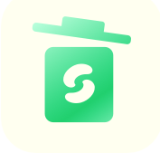
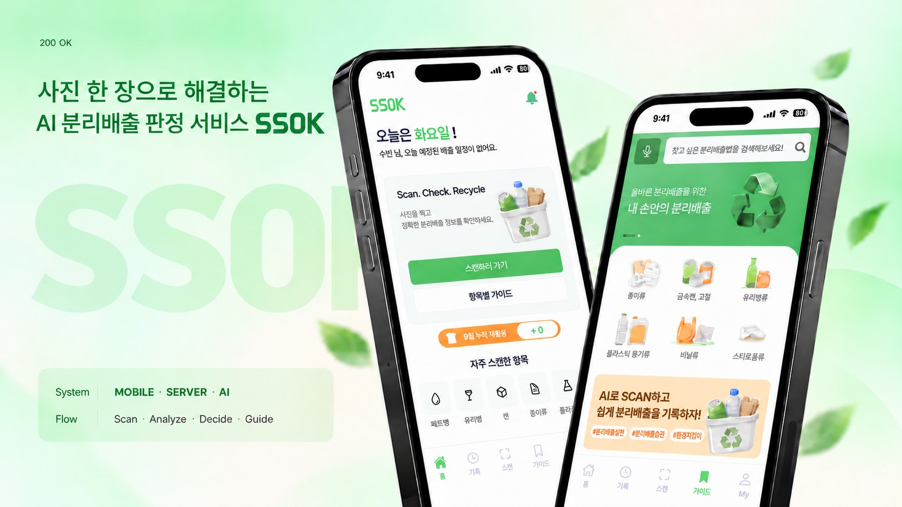
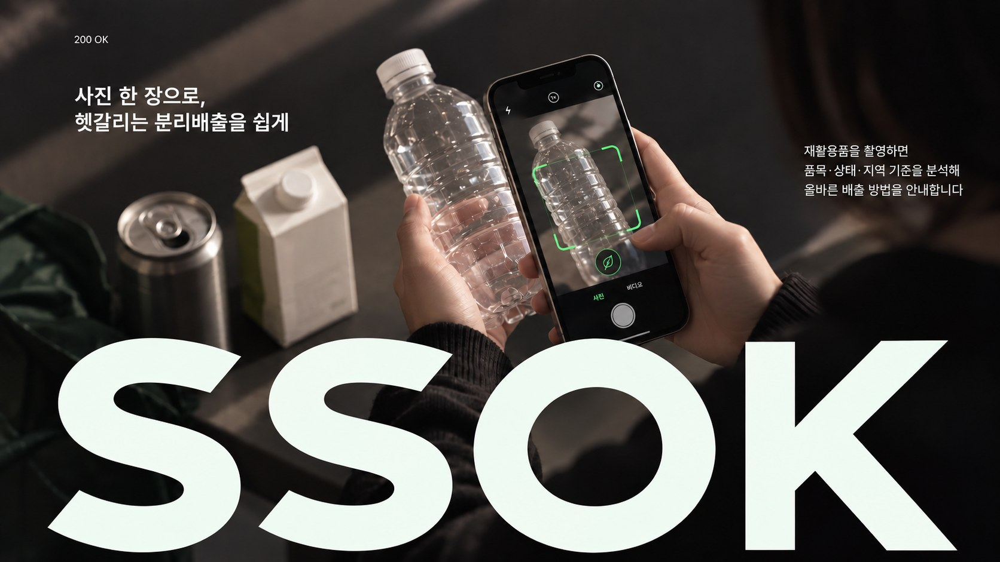
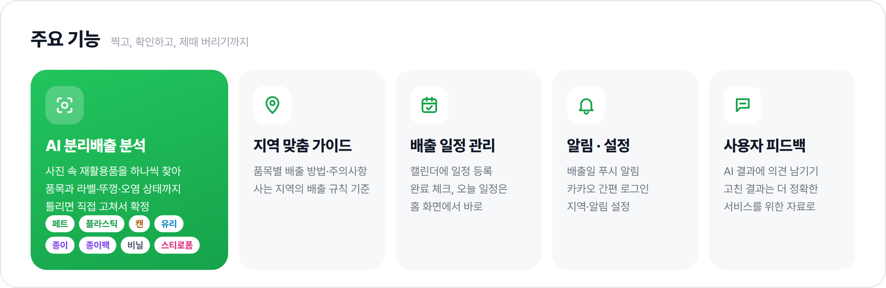
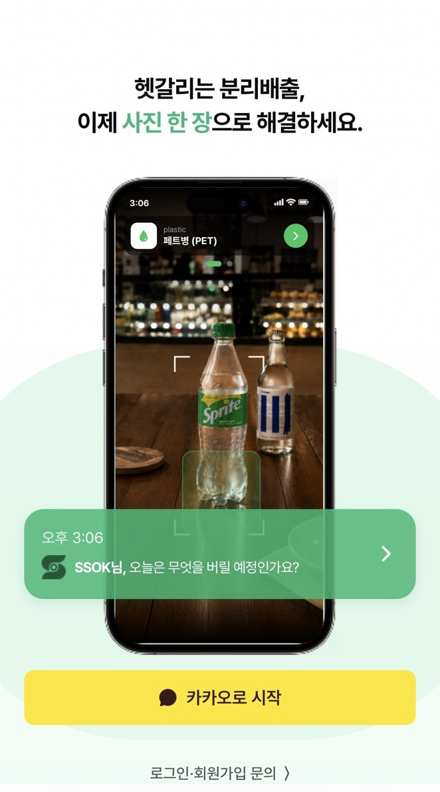
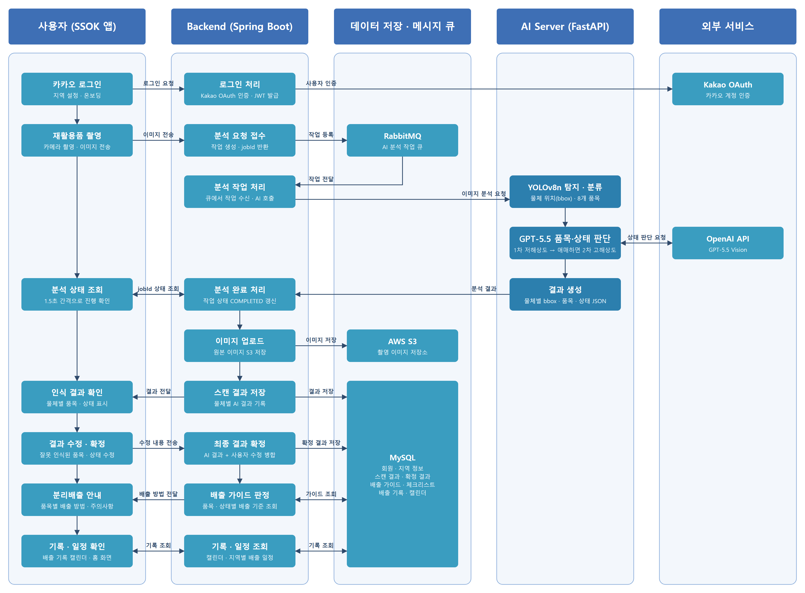
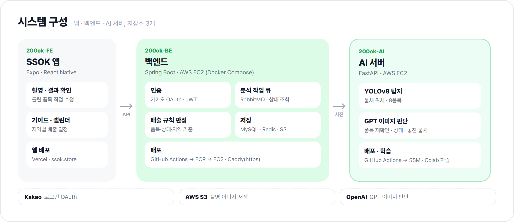

<!-- PROJECT LOGO -->
 

  

  <h1 align="center">SSOK</h1>

  

    헷갈리는 분리배출 정보를 사진 한 장으로 쏙! 
    AI 이미지 분석과 지역별 배출 정보를 활용한 맞춤형 분리배출 서비스
  

  

    
    
    
    
  

  
홍익대학교 컴퓨터공학과 졸업 프로젝트 · 팀 200 OK

  

 

<!-- 프로젝트 소개 -->
## 프로젝트 소개

**SSOK(쏙)** — 버리려는 물건을 촬영하면 AI가 품목·재질·상태를 분석하고, 거주 지역 기준의 분리배출 방법과 일정을 안내하는 서비스

- **문제**: 지역·품목마다 분리배출 기준이 달라 매번 검색 필요, 라벨·뚜껑·오염 여부에 따라 배출 방법도 달라짐
- **해결**: 사진 한 장 → 물건별 품목·상태 판정 → 지역 규칙에 맞는 배출 방법 안내 → 배출 일정·기록 관리
- **기간**: 2026.03 ~ 진행 중

  

 

## 주요 기능

  

<table>
<tr>
<td width="50%" valign="top">

**AI 기반 분리배출 분석**

- 이미지 업로드 → 물건별 품목·재질·상태 분석
- 분석 결과 기준 분리배출 방법 제공
- 잘못 분석된 결과는 사용자가 직접 수정

</td>
<td width="50%" valign="top">

**지역 맞춤형 분리배출 가이드**

- 품목별 분리배출 방법·주의 사항
- 거주 지역 기준 배출 규칙 안내
- 품목명·연관 단어 검색

</td>
</tr>
<tr>
<td width="50%" valign="top">

**분리배출 일정 관리**

- 캘린더에 배출 일정 등록
- 일정 완료 여부 관리
- 오늘의 배출 일정을 홈 화면에 표시

</td>
<td width="50%" valign="top">

**알림 및 사용자 설정**

- 배출 일정 푸시 알림
- 카카오 로그인
- 거주 지역·알림 수신 여부 설정

</td>
</tr>
<tr>
<td colspan="2" valign="top">

**사용자 피드백**

- AI 분석 결과에 대한 의견 등록
- 사용자 수정·피드백 결과를 분석 정확도 개선에 활용

</td>
</tr>
</table>

 

## 사용 흐름

<table>
<tr>
<td width="36%" align="center"></td>
<td valign="middle">

1. **로그인 · 지역 설정** — 카카오 로그인, 거주 지역 등록
2. **촬영** — 버릴 물건 촬영 (한 장에 여러 물건 가능)
3. **결과 확인 · 수정** — 물건별 품목·상태(라벨·뚜껑·오염 등) 확인, 틀린 항목 수정 후 확정
4. **배출 방법 안내** — 품목·상태·지역 기준 배출 방법·주의 사항
5. **기록 · 일정** — 배출 기록, 지역별 배출 일정 (캘린더·홈 화면)

</td>
</tr>
</table>

 

## 서비스 흐름

  

- **비동기 분석**: 백엔드가 분석 요청을 작업 큐(RabbitMQ)에 등록 후 jobId 즉시 반환 → 앱은 상태 조회로 결과 수신
- **AI 분석**: YOLOv8 물체 탐지 → GPT 품목·상태 판단 (1차 저해상도, 애매한 경우만 2차 고해상도)
- **판정·기록**: 사용자 확정 결과 기준으로 백엔드가 품목·상태·지역별 배출 방법 판정, 결과·기록 저장

 

## 시스템 구성

  

| 저장소 | 역할 | 주요 기술 |
|---|---|---|
| [200ok-FE](https://github.com/200ok-Hongik/200ok-FE) | SSOK 앱 · 웹 | Expo, React Native, TypeScript, Vercel |
| [200ok-BE](https://github.com/200ok-Hongik/200ok-BE) | 인증, 분석 작업 관리, 배출 규칙 판정, 기록·일정 | Spring Boot, RabbitMQ, MySQL, Redis, AWS S3·EC2 |
| [200ok-AI](https://github.com/200ok-Hongik/200ok-AI) | 사진 속 재활용품 품목·상태 분석 | FastAPI, YOLOv8, OpenAI GPT, AWS EC2 |

 

## 팀원

| 이름 | 학교 | 역할 | 참여 기간 | 비고 |
|:---:|:---:|:---:|:---:|:---:|
| 유영주 | 홍익대학교 컴퓨터공학과 | `팀장` `AI 개발자` | MVP 개발 ~ 현재 | GitHub · Blog |
| 김지현 | 홍익대학교 컴퓨터공학과 | `백엔드 개발자` | MVP 개발 ~ 현재 |   |
| 김혜원 | 홍익대학교 컴퓨터공학과 | `AI 개발자` | MVP 개발 ~ 현재 |  Velog |
| 최수민 | 홍익대학교 컴퓨터공학과 | `프론트엔드 개발자` | MVP 개발 ~ 현재 | Velog |
| 정유민 | - | `디자이너` | MVP 개발 ~ 현재 | - |
| 정용빈 | - | `디자이너` | MVP 개발 ~ 현재 | - |

 

## 기술 스택

#### **Frontend**

#### **Backend**

#### **AI**

#### **Database**

#### **Infra / CI·CD**

#### **협업 도구**

 

## 관련 링크

#### SSOK 프로젝트 레포지터리

- [SSOK 서비스](https://ssok.store)
- [GitHub - Frontend](https://github.com/200ok-Hongik/200ok-FE)
- [GitHub - Backend](https://github.com/200ok-Hongik/200ok-BE)
- [GitHub - AI](https://github.com/200ok-Hongik/200ok-AI)

 
 

<h2></h2>

 

### 헷갈리는 분리배출, 이제 쏙 알아보세요.

사진 한 장이면 분리배출 방법부터 일정까지 한눈에. 
우리의 작은 실천이 더 나은 내일로 이어지도록, **SSOK**과 함께해요.

 
